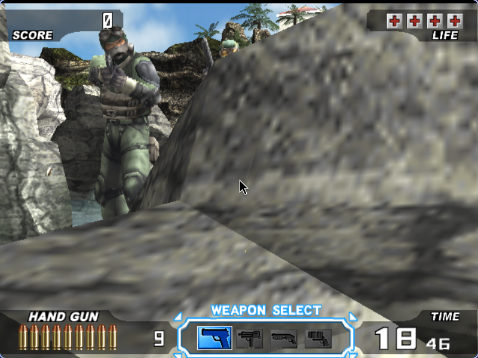
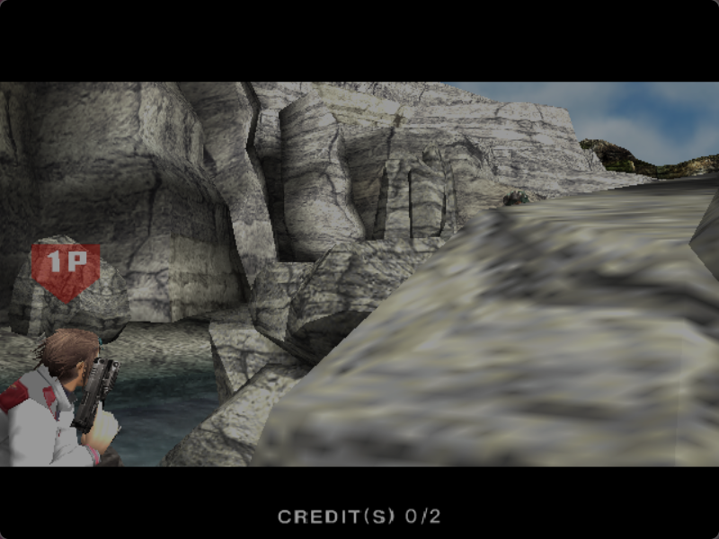
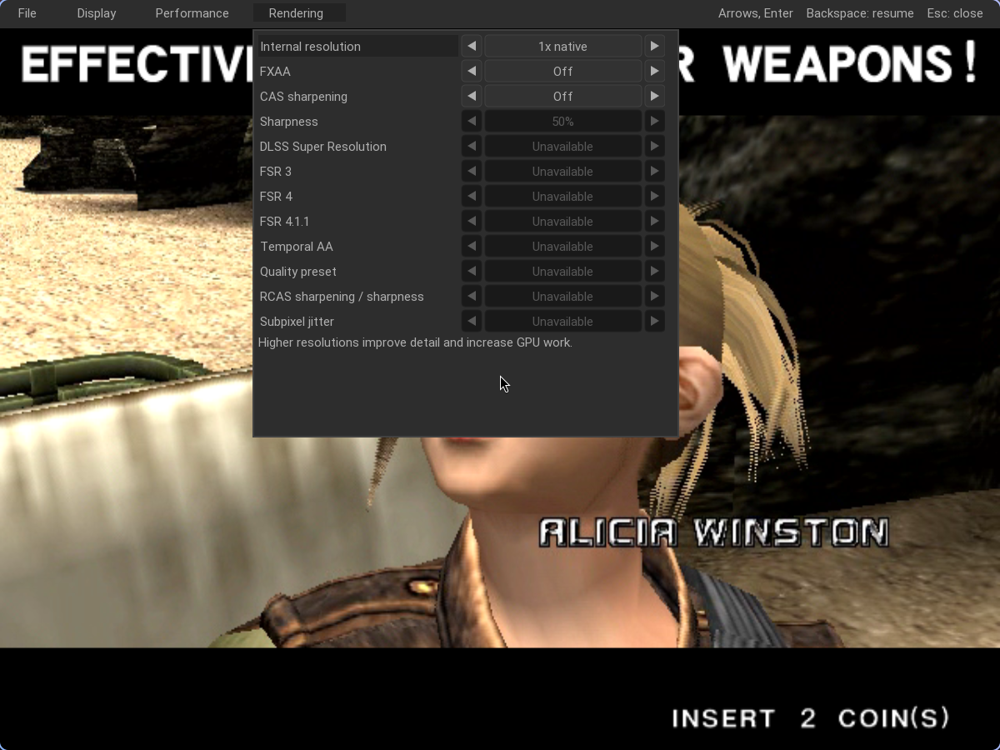

# Time Crisis 3 Native · Linux / Vulkan

A game-specific Linux reconstruction of the **Time Crisis 3 arcade version**, with a Vulkan renderer, SPU2 audio and a DriveClub-style Nuklear menu. The playable foundation embeds a pinned PCSX2x6 core in `tc3-native`; it has no Qt frontend or external emulator process. **Whole-game native translation remains in development.**

The default launcher runs two linked cabinet workers, each with its own arcade camera and mutable storage. A solo **LINK PLAY** session displays the uncredited partner camera on the right. Presentation currently uses two adjacent windows.

| Player 1 cabinet | Uncredited partner cabinet |
| --- | --- |
|  |  |

These are captures of the running compatibility foundation. The historical stage-one freeze point, complete-stage speed, exact aim alignment and audio equivalence remain unverified.

## Start here

- [Build and private asset setup](docs/BUILD.md)
- [Dual-screen arcade setup](docs/DUAL_SCREEN.md)
- [Controls and playtesting](PLAYTEST.md)
- [Sinden detection, borders and official Linux driver](docs/SINDEN.md)
- [Original cabinet test and maintenance menu](docs/CABINET_TEST.md)
- [Testing and current acceptance gates](docs/TESTING.md)
- [Current implementation status](STATUS.md)

The separate TC4 project is [TimeCrisis4-Native](https://github.com/CrownParkComputing/TimeCrisis4-Native).

## Run

After following the build and asset instructions:

```sh
python3 tools/run_tc3.py
# Single cabinet:
python3 tools/run_tc3.py --single
```

Use **5** for coins, **Enter** to start, **mouse / left click** to aim and fire, and hold **Space** to press the pedal. Start the left cabinet and shoot **LINK PLAY** to show both arcade views. **F10** opens Nuklear and pauses both cabinets. Arrows and Enter navigate; Esc or Backspace resumes.

The menu exposes internal resolution 1–4x, FXAA, CAS sharpening and strength, VSync, presentation queue, Sinden Auto/On/Off borders and border width. Rendering and border settings apply to both cabinets and are saved. Cabinet/Test actions operate the original JVS test/service controls on the selected cabinet. See the maintenance guide before changing original game settings.



The rendering capture predates the added Cabinet/Test tab; it shows actual connected rendering controls. DLSS, temporal FSR and frame generation remain unavailable. Android and touchscreen controls are planned; there is no Android release yet.

## Component tests

These tests use synthetic inputs and require no game, firmware, Vulkan or SDL installation:

```sh
cmake -S . -B build -DTC3_BUILD_HOST=OFF -DTC3_BUILD_NATIVE_BLOCK_TESTS=OFF -DCMAKE_BUILD_TYPE=Release
cmake --build build -j2
ctest --test-dir build --output-on-failure
```

They cover executable parsing, replay acceptance, rendering capability gates and settings, Sinden detection/border geometry, real local packet transport, original receive-queue behavior and shared cabinet control. They do not establish completed stage progression or 60 FPS gameplay.

## Source and licensing

The compatibility foundation is [PS2Homebrew-arcade/pcsx2x6](https://github.com/PS2Homebrew-arcade/pcsx2x6), pinned in [pcsx2.lock.json](third_party/pcsx2.lock.json). The project preserves the upstream scheduler, hardware semantics and execution backend while title-specific native blocks are validated against it. The optional scalar proof covers seven instructions, not the full game.

Project code is GPL-3.0-or-later; see [COPYING](COPYING) and [third-party notices](THIRD_PARTY_NOTICES.md). Game screenshots illustrate compatibility testing; game content and trademarks belong to their respective owners. No game media, dongle cards, BIOS, savestates or Sinden driver binaries are included. Supply your own assets.
