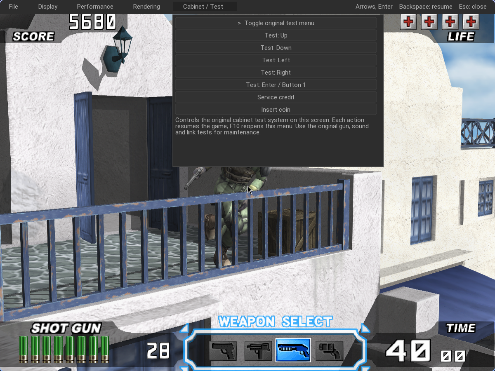

# Cabinet test and maintenance

Press **F10**, then select **Cabinet / Service** with Tab or the mouse. Use arrows and Enter for menu navigation.

## Direct service settings (recommended)

The original cabinet options are edited directly — player's life, difficulty, hit color, free play, game cost, continue cost and attract sound — for both TC3 (`TST-03A` block, additive checksum) and TC4 (`TSF100-2-NA` block, CRC16). **Save & Reset Machine** writes the EEPROM, mirrors the backup region, publishes the settings to the linked peer and reboots both cabinets together, so the pair always runs one identical configuration. Service credit and Insert coin are on the same page.

## Original test menu (diagnostics)

**F9** toggles the original JVS test DIP switch on both linked screens. The native help overlay lists the mapped keys: arrows move and adjust, **E** selects/confirms, **Return** starts, **9** service credit, **5** inserts a coin. Use the game's own I/O, gun, sound and bookkeeping pages for calibration and deep diagnostics; finish its original exit/save procedure normally.

For TC3 linked workers the pair shares one EEPROM image: a save on either screen propagates and both machines reset together. TC4's linked pair uses the same shared menu with its own AN986/UDP link bridge.

Hardware calibration and full maintenance workflows need testing on the intended gun/cabinet setup. Use private copies of SRAM and dongles as described in the setup guide. No factory reset or storage-erasing action is added to Nuklear.
