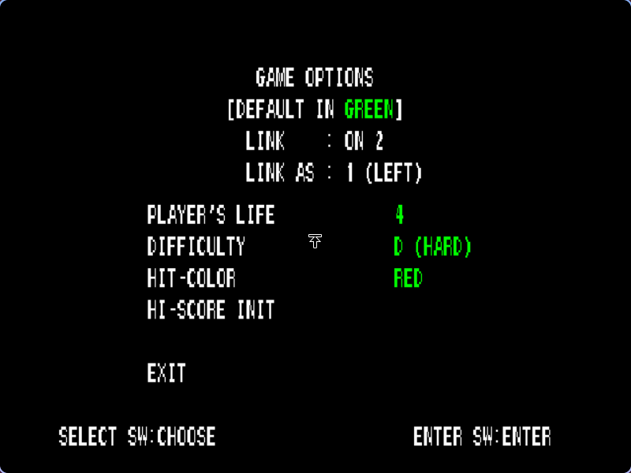

# Two original arcade views

TC3 uses two independently booted cabinet workers linked over a native local Unix socket transport. Each has its own EE/IOP/VU state, SRAM, dongle and Vulkan window. The right picture is the original second camera, not a copy of the left.

1. Complete [build and asset preparation](BUILD.md).
2. Run `python3 tools/run_tc3.py` (twin is the default).
3. Allow both cabinets to boot. Focus the left window, insert the required coins with `5`, then press Enter.
4. Shoot **LINK PLAY** in the game's mode selection. A single credited left player is enough for the original uncredited right-side spectator camera during linked gameplay.
5. Aim/fire with the mouse; hold Space to attack. F10 in either window pauses both. Esc/Backspace resumes when neither menu remains open.

The original GAME OPTIONS screen was observed reporting `LINK: ON 2`. If an imported SRAM has link disabled, use [Cabinet/Test](CABINET_TEST.md), follow the game's original link setup and exit normally. Do not replace a working SRAM while either worker runs.

## Displays and input

The current output is **two adjacent windows**. Hyprland placement is automated for the focused display. On other desktops place the windows manually; move one to each physical display if desired. A single combined compositor and automatic cross-monitor fullscreen are not implemented. Keep each 4:3 view visible without overlap.

Sinden borders surround **each game rectangle** separately, including when two windows share one physical monitor. See [Sinden setup](SINDEN.md). The default mouse input targets the focused window. Independent simultaneous two-gun routing to separate workers is not yet implemented or hardware tested; USB detection alone does not provide it.

## Shared controls and storage

Rendering settings and Sinden border mode/width propagate to both workers. Opening a menu stops guest execution on both, while the menu continues redrawing. Quit closes both. Original cabinet test/service inputs apply only to the window whose Nuklear menu issued them, and resume execution so the original board can process them.

Worker storage is `.local/cabinet-left` and `.local/cabinet-right`; media is shared read-only. Logs and PIDs are recorded in `.local/cabinet-pair-run.json`. F1/F3 save/load is disabled for the linked pair because paired snapshots are not implemented.

## Current limits

A solo linked stage-one camera pair has been observed. Full-stage synchronization, recovery after disconnection, coordinated reset, two-player completion and the historical freeze point remain unverified. Audio currently comes from the cabinet workers; a cabinet-aware mixer is not implemented. Performance depends on running two full compatibility cores and the selected resolution. Use the Performance page's game/video/speed readings; menu refresh or generated frames do not establish game speed.
