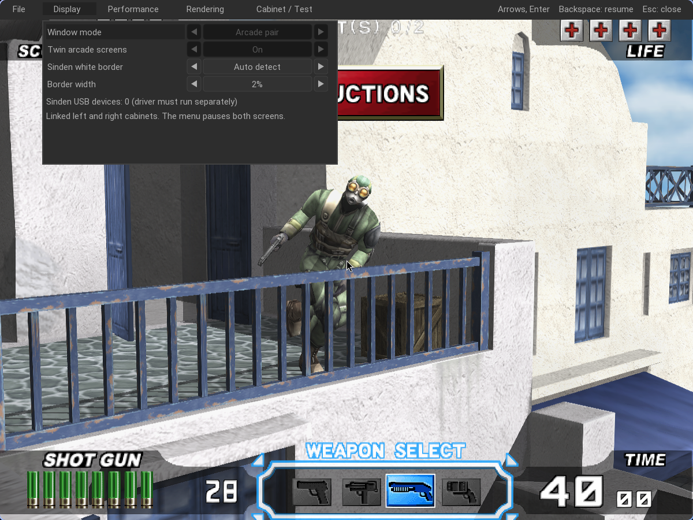

# Sinden lightguns on Linux

## Driver

Install the manufacturer's software from the [official Sinden driver page](https://sindenlightgun.com/drivers/). Checked 24 October 2026: the page lists **v2.08b** as the main download, with Linux x86 software included. The driver runs separately and supplies pointer/button input. Follow the README shipped with that version for runtime packages, device permissions, calibration, selection of the gun and starting its Linux process. This repository does not install a privileged service, change udev rules or bundle Sinden's driver binaries.

The manufacturer's older [Linux utilities repository](https://github.com/SindenLightgun/SindenLightgunLinux) documents Linux setup, and its [USB rule](https://github.com/SindenLightgun/SindenLightgunLinux/blob/v1.5.3/DeviceScripts/99-sinden-lightgun.rules) identifies VID/PID `32e4:9210`. That repository includes older Raspberry Pi paths and scripts: do not run its system-wide installer blindly on a desktop Linux installation. Current download instructions take precedence over older Mono command examples.

The manufacturer's driver download carries its own redistribution terms; download it from Sinden. No firmware upgrade or recoil configuration is performed by this application.

## Driver archive details

The current v2.08b archive actually contains a folder named `SindenLightgunLinuxSoftwareV2.05`. For a conventional Linux PC, inspect `PCversion/Standard/Lightgun`; an additional `Ubuntu_Version22_04_Beta/LightgunUbuntu_22_04` variant is included. The bundled standard README borrows Steam Deck instructions and advises first establishing a working older PC driver setup. Treat those platform-specific system commands as examples, not an automatic desktop installer.

The Linux executable is **LightgunMono.exe**, run by **Mono**. The standard package uses SDL 1.2 / SDL_image support for its calibration interface; these are separate from this game frontend's SDL3 dependency. Install the matching Mono and native library packages for your distribution and grant the driver the required USB/camera/serial permissions according to its guide. Do not change firmware or add outdated distribution repositories merely to launch the game.

Typical mouse-mode commands from inside the selected driver folder are:

```sh
mono LightgunMono.exe sdl   # Open the driver calibration interface.
mono LightgunMono.exe       # Start pointer output; keep this process running.
```

Calibration exits separately; start pointer output again afterward. The package also offers `mono-service` startup scripts. Do **not** add the `joystick` argument for this frontend's current mouse input path. Driver/recoil/two-device configuration remains in Sinden's software. These commands have been checked against the official archive, but have not been exercised with a connected gun on this machine.

## In-game options



Open **F10 → Display**:

- **Sinden white border → Auto detect** (default): show borders while a Sinden USB device is present.
- **On**: force borders, useful for setup, renamed devices or driver implementations whose USB descriptors differ.
- **Off**: disable application borders.
- **Border width**: 1–5% of the shorter game-view dimension; default 2%.
- **Sinden USB devices**: count of matching physical USB devices, rescanned about once per second.

Detection checks Linux sysfs for Sinden product names or the manufacturer-published VID/PID. It counts physical devices rather than each composite USB interface. **A detected device is not proof that its camera driver is running or tracking.** No connected hardware is required to force the border on for testing.

A separate white rectangle surrounds each game's displayed view, with a black inner gap. The actual game image is inset without changing its aspect ratio. The GS draw rectangle used for aiming is updated to the same image rectangle, so window scaling, letterboxing and border changes share one mapping. Borders redraw immediately while paused. In TC3 twin mode the mode and width are saved and mirrored to both workers. Each game's separate data root retains its own preferences.

## Calibration and two screens

Start and calibrate the official driver first, then use the original game's gun test through [Cabinet/Test](CABINET_TEST.md) to verify center and corner hits. Keep all four border edges visible. Avoid adding a second conflicting whole-desktop border when using the application's per-view borders. With two visible rectangles on one monitor, verify the driver's selected display/region; the application cannot guarantee which rectangle the gun camera will lock onto.

The current frontend accepts the driver's mouse output in the focused game window. **Independent simultaneous routing of two physical guns to two cabinets is not implemented.** Detection does not bind a gun serial number to a player, manage driver processes or implement recoil. Hardware tracking, corner accuracy, hotplug under an active driver and two-gun play remain to be tested with real Sinden devices.

TC4 uses the same shared frontend options, but its cabinet link transport is separate work. A TC4 border or USB count does not imply TC4 dual-screen support.

For reliable tracking, disable desktop dimming, translucency and rounded clipping on the game windows. The renderer emits neutral white; desktop effects can dim or clip its edges before the gun sees them.


The capture above uses forced On mode during a software check, with no physical gun attached.
